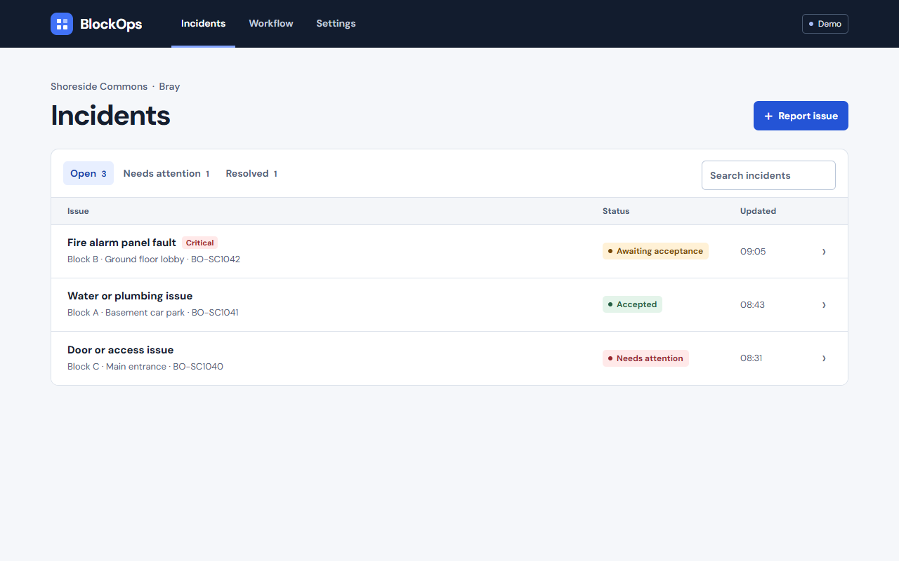
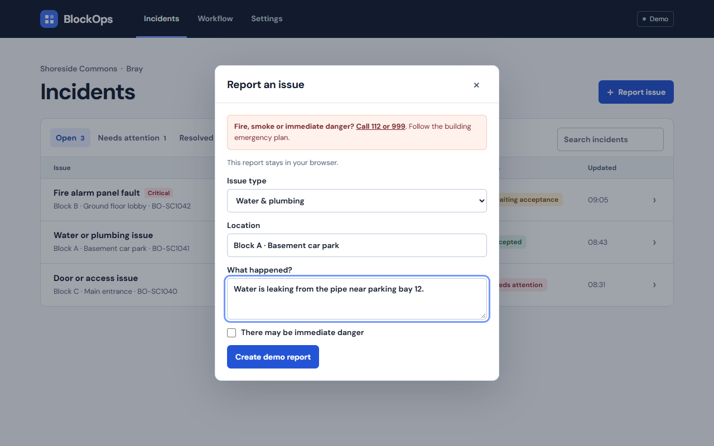
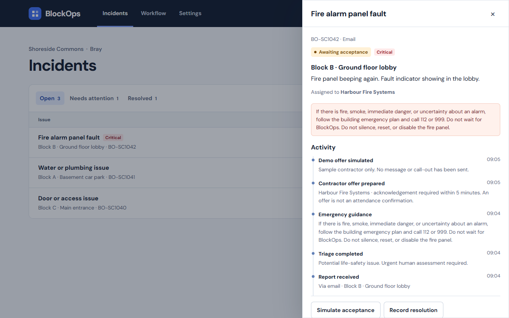
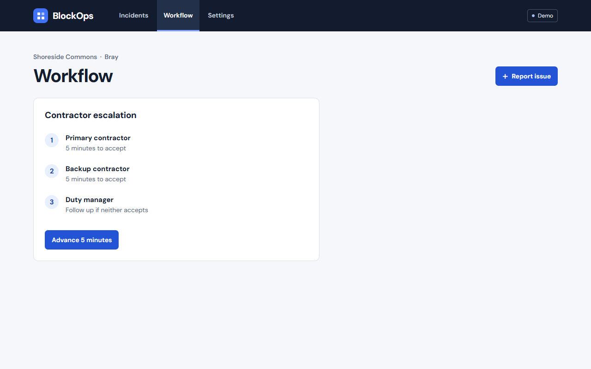
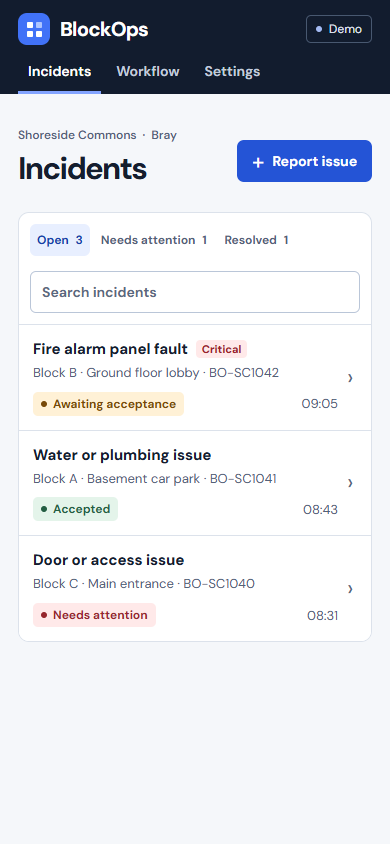

# BlockOps

BlockOps helps residents report building faults and helps property managers organise a response, day or night.

It started at **Shoreside Commons, Sea Gardens, Bray**, where recurring fire alarm panel faults highlighted the need for a clear way to report an issue out of hours and reach someone who can help.

[Open BlockOps](https://blockops-mu.vercel.app/) · [Try the local demo](#try-the-demo) · [Deployment guide](#vercel-email-pilot)



*Screenshots use demo incidents and fictional contractors.*

## How it works

1. **Report a fault.** Residents use the web form or send an email. The WhatsApp integration accepts direct text messages once a Meta sender is connected.
2. **Choose the response.** A duty manager can approve a contractor offer. Eligible reports can also be routed automatically when configured.
3. **Reach the right person.** The approved contractor receives an email with the fault, location and a link to accept the call-out. If the primary contractor does not accept within five minutes, the workflow tries the backup, then escalates to the duty manager.
4. **Follow the incident.** The desk keeps an activity history of reports, offers, acceptance and resolution.

<details>
<summary>See reporting, incident activity, escalation and the mobile view</summary>

### Reporting an issue



### Following the response



### Contractor escalation



### On your phone



</details>

## Try the demo

You need [Bun](https://bun.sh/). The project uses TypeScript 7.

```sh
git clone https://github.com/georgesterpu/BlockOps.git
cd BlockOps
bun install
bun run preview
```

Open `http://localhost:3000` and explore the sample incidents.

- Open a fault to see its activity and simulate contractor acceptance.
- Use **Report issue** to add your own sample report.
- Open **Workflow** and choose **Advance 5 minutes** to try the escalation sequence.

The demo keeps its changes in your browser and simulates notifications. The hosted app provides the incident desk for signed-in operators and a reporting form for residents.

## Built with

| Part | Technology |
| --- | --- |
| Development | Bun and TypeScript 7 |
| Hosted API | Next.js on Vercel |
| Dispatch and escalation | Vercel Workflow SDK |
| WhatsApp direct messages | Vercel Chat SDK and Meta WhatsApp Cloud API |
| Email reports and call-out offers | Resend |
| Hosted incident data and settings | Private Vercel Blob storage in Dublin |
| Local server storage | SQLite |

To run the local server with SQLite, copy `.env.example` to `.env`, choose a desk password, session secret and resident access code, then run `bun run dev`. Open **Settings** to sign in and configure routing. Run `bun run verify` for the TypeScript checks, tests and browser asset build.

## Using BlockOps

BlockOps is a maintenance coordination prototype. A property needs approved contractors, an agreed duty roster and call-out authority before enabling live dispatch.

**For fire, smoke or immediate danger, follow the building emergency plan and call 112 or 999.** An email or a recorded ticket cannot confirm that help is attending.

## Vercel email pilot

Import the repository as a Vercel project. The project builds with Bun and uses the Next.js adapter for Vercel Workflow. The same incident rules run locally and in Vercel steps. Vercel suspends the workflow between acknowledgement deadlines and resumes it when a deadline or delivery retry is due.

1. Connect a private Vercel Blob store in the project’s Storage tab. Vercel adds `BLOB_READ_WRITE_TOKEN` automatically. The pilot stores its incident data in a private JSON document with consistent reads and conditional updates. Local development uses SQLite.
2. Set `PUBLIC_URL` to your production origin, `DEMO_MODE=false`, and `LIVE_DISPATCH=false`. Set `OPERATOR_PASSWORD` (at least 16 characters), `SESSION_SECRET` (at least 32 random characters), and `RESIDENT_ACCESS_CODE` as private environment variables.
3. Create a Resend key with access to retrieve incoming messages and send replies. Save it as `RESEND_API_KEY` in the project. `EMAIL_INBOX` and `EMAIL_FROM` default to `reports@blockops.january.ie`. Use an address on your verified sending and receiving domain for other deployments.
4. Redeploy after saving the variables. Sign into BlockOps, open **Settings**, and choose **Connect Resend**. BlockOps registers the `email.received` webhook and stores its signing secret in private storage. A manually configured `RESEND_WEBHOOK_SECRET` is also supported.
5. Enrol your own sender address in **Email routing**. Send a sample report from that address to the inbox. You should receive a reference and see the incident in the desk. This test keeps contractor and manager notifications simulated.

The webhook checks the provider signature and uses the received email ID to prevent duplicate incidents. Resend replies are queued with stable idempotency keys. The desk distinguishes a provider accepting a message from a contractor accepting a call-out.

An email with `Location: Block B lobby` is sufficient for location extraction. Include `Code: <resident access code>` on its own line if the building enables automatic offers. The code is removed from the incident text. Without an enrolled sender, the app ignores the message. With a missing code, ambiguous location or signs of danger, the report waits for manager review. The manager can approve a maintenance offer from the incident detail.

Agree the overnight roster and call-out authority before setting `LIVE_DISPATCH=true`. Email offers have a five-minute acceptance window. The workflow tries the backup and then the duty manager. Email delivery alone cannot guarantee an immediate response. Use the optional signed dispatch webhook for an agreed SMS or phone notification channel.

## WhatsApp direct messages

BlockOps uses [Vercel Chat SDK's official WhatsApp adapter](https://chat-sdk.dev/adapters/official/whatsapp) with Meta's WhatsApp Business Cloud API. Use Meta's test number for the first phone test. A residents' group can pin a link that opens a private chat with the BlockOps number.

1. Create a Meta Business app, add WhatsApp, and add your personal phone as a test recipient.
2. In Vercel, set `WHATSAPP_ACCESS_TOKEN` and `WHATSAPP_PHONE_NUMBER_ID` from WhatsApp API Setup, and `WHATSAPP_APP_SECRET` from App Settings. Generate a random `WHATSAPP_VERIFY_TOKEN` and set `WHATSAPP_RESIDENT_PHONES` to enrolled numbers in international format, separated by commas.
3. Redeploy. In Meta's WhatsApp Configuration, set the callback to `https://blockops-mu.vercel.app/api/webhooks/whatsapp`, enter the same verify token, and subscribe to `messages`. For production, use a dedicated sender and a system-user token.
4. Send a DM containing `Location: Block B lobby` on its own line followed by a description of the fault. BlockOps replies with the incident reference. If the location or description is missing, BlockOps asks the resident to resend both together.

WhatsApp reports use the same incident desk and email dispatch workflow. Potential life-safety reports go to duty manager review. Other reports can trigger automatic offers when enabled and an approved primary contractor is configured. For the first test, use a test contact and mark the report clearly as a test.

The legacy Twilio webhook routes are also available for deployments already using them.

## Get involved

Feedback from residents, property managers and contractors is welcome. Try the demo and [open an issue](https://github.com/georgesterpu/BlockOps/issues) with a confusing interaction, a missing step or an idea that would make an overnight incident easier to handle. Use fictional details when sharing examples.
